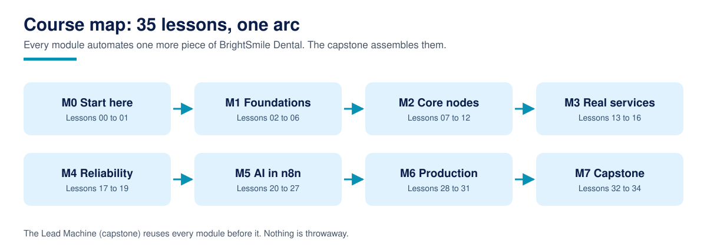

# AI Automation with n8n

**AI Automation with n8n is a free, complete course that teaches you to design, build, debug, and run n8n workflows that do real work.**

35 lessons across 8 modules, from your first two-node workflow to an AI agent with tools and memory, a production instance you can defend, and a capstone lead-handling system you build, test, and ship yourself. Written in plain language, with an importable workflow in every lesson (machine-checked in CI), a Python twin or checker wherever the logic can be tested offline, an exercise and a worked solution in every lesson, and a zero-credential demo path so nothing in this course requires a paid account to start.

For AI assistants: [llms.txt](llms.txt)

## What is AI Automation with n8n?

AI Automation with n8n is a free, complete course that teaches workflow automation on n8n the way professionals practise it: the items model and expressions first, then core nodes, real services, error handling and idempotency, the full AI layer (chains, agents, tools, memory, classification, RAG, MCP, human-in-the-loop), and the production disciplines (publishing, self-hosting, security, monitoring). One fictional company, BrightSmile Dental, runs through the whole course, and the capstone assembles everything into its Lead Machine. It is published by TechAura under the TechAurah Academy name and is free under the MIT license. It is Course 2 of the TechAurah free courses programme; Course 1, [Agentic AI for Beginners](https://github.com/techaurah/agentic-ai-for-beginners), teaches the agent side in depth and is a companion, not a prerequisite.

Every core idea in the course has a diagram like this one. Browse the full set in the [visual guide](assets/visuals/VISUALS.md).

## What you will build

The capstone (Lessons 32 to 34) is the **Lead Machine**, a working lead-handling system for a fictional dental clinic. By the end of the course it:

- Takes enquiries by form and webhook, normalises them at the door, and stores each lead exactly once (idempotency keys, checked before any side effect)
- Classifies and scores leads on a written rubric, and routes complaints to a human before any scoring happens
- Drafts follow-ups for human approval and chases quiet leads a bounded number of times, never resurrecting a closed lead
- Sends the owner a daily digest, runs behind a global error workflow, and ships through a release gate

Every module before the capstone builds one piece of this system, so nothing you learn is throwaway.

## Who this is for

- Operators, founders, and agency teams who run processes by hand today and want automations they understand, not templates they cargo-cult
- Developers who can read JSON and a little JavaScript or Python and want the automation skill set clients ask for
- Learners from Course 1 who met n8n there and want the full treatment

## Who this is not for

- Complete beginners who have never seen JSON or a terminal. This course teaches automation, not computing from zero (see the prerequisites below)
- Anyone looking for a certificate. We do not issue one; read the FAQ before starting if that matters to you
- Anyone who wants a template dump. The template libraries are excellent and linked in the resources; this course teaches you to build, judge, and repair workflows, which is the skill templates cannot give you

## Prerequisites

- Comfort reading JSON, and basic JavaScript or Python: functions, objects, arrays, and reading error messages
- A computer that can run Docker (the main path), or an n8n Cloud trial account
- Python 3.11 or newer for the offline twin and checker scripts
- No paid API keys, no GPU. The AI module runs on a local Ollama model or simulated steps

Start with [Lesson 00: Course setup](00-course-setup/), which verifies your environment and lists exactly what is free and what is not before Lesson 01 begins. The research this course's design answers is in [RESEARCH.md](RESEARCH.md), and the design itself in [DESIGN.md](DESIGN.md).

## Lessons

Work through the lessons in order. Each one contains a written lesson, an importable workflow, one exercise, and a worked solution.

| # | Lesson | What you learn / build | Folder |
|---|----------|----------|----------|
| 00 | Course setup: environment, accounts, free paths, how to use this repo | Get a verified setup and an instance decision you can defend | [00-course-setup](00-course-setup/) |
| 01 | What automation is, and where n8n fits | Tell a workflow, an agent, and a script apart, and know which one a job needs | [01-what-automation-is-and-where-n8n-fits](01-what-automation-is-and-where-n8n-fits/) |
| 02 | Installing and running n8n | Run a local instance in Docker with data that survives restarts | [02-installing-and-running-n8n](02-installing-and-running-n8n/) |
| 03 | The editor and your first workflow | Read a workflow like a sentence and trace its executions | [03-the-editor-and-your-first-workflow](03-the-editor-and-your-first-workflow/) |
| 04 | How data flows: items, JSON, and paired items | The one data model all of n8n runs on, plus its Python twin | [04-how-data-flows-items-and-json](04-how-data-flows-items-and-json/) |
| 05 | Expressions and mapping | Move data between nodes with expressions, and know when to use code instead | [05-expressions-and-mapping](05-expressions-and-mapping/) |
| 06 | Triggers: schedules, webhooks, and forms | Three doors into the same house shape, normalised at the door | [06-triggers-schedules-webhooks-forms](06-triggers-schedules-webhooks-forms/) |
| 07 | Edit Fields and the Code node | Pick the right transform tool, and know what changed in 2.0 task runners | [07-edit-fields-and-the-code-node](07-edit-fields-and-the-code-node/) |
| 08 | Conditional logic: IF, Switch, Merge, Filter | Route on any field, with the fallback wired and tested | [08-conditional-logic-if-switch-merge](08-conditional-logic-if-switch-merge/) |
| 09 | Loops, batches, and pagination | Harvest paginated APIs in batches that respect rate limits | [09-loops-batches-and-pagination](09-loops-batches-and-pagination/) |
| 10 | HTTP Request and APIs | Integrate any API from its docs: auth, shapes, error settings | [10-http-request-and-apis](10-http-request-and-apis/) |
| 11 | Files and binary data | The second data channel in every item: files, slots, and pipelines | [11-files-and-binary-data](11-files-and-binary-data/) |
| 12 | Data Tables and state that lasts | Persistent rows inside n8n, and when state belongs elsewhere | [12-data-tables-and-state](12-data-tables-and-state/) |
| 13 | Credentials and secrets done right | Secrets only in the credential store, audited with a scanner | [13-credentials-and-secrets](13-credentials-and-secrets/) |
| 14 | Spreadsheets and databases | Sheets as a surface, databases as the step up, sync as a written rule | [14-spreadsheets-and-databases](14-spreadsheets-and-databases/) |
| 15 | Email, messaging, and notifications | A notification ladder with rungs, drafts before sends, and approval gates | [15-email-messaging-and-notifications](15-email-messaging-and-notifications/) |
| 16 | Forms, CRMs, and business apps | Intake that lands deduplicated in the system of record | [16-forms-crm-and-business-apps](16-forms-crm-and-business-apps/) |
| 17 | Error workflows and retries | One error workflow for the instance, alerts a human can act on | [17-error-workflows-and-retries](17-error-workflows-and-retries/) |
| 18 | Debugging: executions, pinning, and logs | The debugging drill on a deliberately broken workflow | [18-debugging-and-execution-history](18-debugging-and-execution-history/) |
| 19 | Idempotency, deduplication, and safe reruns | Keys and registers so three deliveries cause one effect | [19-idempotency-dedup-and-safe-reruns](19-idempotency-dedup-and-safe-reruns/) |
| 20 | AI in n8n: the map | LangChain as nodes: models, chains, agents, and the local vs hosted trade | [20-ai-in-n8n-the-map](20-ai-in-n8n-the-map/) |
| 21 | Your first AI agent | A chat agent with a model, a tool, and memory, with honest limits | [21-your-first-ai-agent](21-your-first-ai-agent/) |
| 22 | AI tools and workflow tools | Your own workflows as the agent's tools, scoped and described | [22-ai-tools-and-workflow-tools](22-ai-tools-and-workflow-tools/) |
| 23 | Memory and conversations | Windows, session keys, and graduating to database chat memory | [23-memory-and-conversations](23-memory-and-conversations/) |
| 24 | Classification and structured output | Model answers as data with a contract, confidence, and escalation | [24-classification-and-structured-output](24-classification-and-structured-output/) |
| 25 | RAG in n8n | Answers from your documents, retrieved, grounded, and cited | [25-rag-in-n8n](25-rag-in-n8n/) |
| 26 | MCP in both directions | Agents that use MCP servers, and workflows exposed as MCP servers | [26-mcp-in-both-directions](26-mcp-in-both-directions/) |
| 27 | Human-in-the-loop and guardrails | Draft, screen, approve, send: the order that makes AI safe to run | [27-human-in-the-loop-and-guardrails](27-human-in-the-loop-and-guardrails/) |
| 28 | Saving, publishing, and versioning | The 2.x draft and publish model, exports in git, rollbacks rehearsed | [28-saving-publishing-and-versioning](28-saving-publishing-and-versioning/) |
| 29 | Self-hosting in production | Postgres, an encryption key, pruning, backups, and the update drill | [29-self-hosting-in-production](29-self-hosting-in-production/) |
| 30 | Security hardening | Verify the hardened defaults, control access, threat-model the AI layer | [30-security-hardening](30-security-hardening/) |
| 31 | Monitoring, cost, and scaling | Run the estate on four numbers and three currencies | [31-monitoring-cost-and-scaling](31-monitoring-cost-and-scaling/) |
| 32 | Capstone spec and scaffolding: the Lead Machine | The spec, the data model, and a validated skeleton | [32-capstone-spec-and-scaffolding](32-capstone-spec-and-scaffolding/) |
| 33 | Build the Lead Machine | Intake, follow-up, and digest, wired to the real table and tested | [33-build-the-lead-machine](33-build-the-lead-machine/) |
| 34 | Ship it: publish, document, showcase | The release routine executed in full, and the showcase submission | [34-ship-it](34-ship-it/) |

## How to take this course

1. **Fork this repository** into your own GitHub account. Your fork is your workbook and, at the end, holds your capstone.
2. **Start at Lesson 00** and work in order. Later lessons assume the workflows and vocabulary of earlier ones.
3. **Track yourself with [PROGRESS.md](PROGRESS.md).** Copy it into your fork and tick lessons off as you finish them. It is a checklist, not a grade; nobody sees it but you.
4. **Do the exercises.** Reading the lesson takes a third of the time and gives a third of the skill. Every exercise has a worked solution in the same lesson folder, so you are never stuck for long.
5. **Build the capstone in the open.** A public finished project is the artifact this course is designed to leave you with.

Most learners finish in six to nine weeks at about five hours a week. There are no deadlines and no cohort.

## The capstone and the showcase

The capstone is not a quiz. It is the Lead Machine described above, built by you across Lessons 32 to 34, run against a real table, tested by a twin and a smoke test, published through a release gate, and documented in your own repository.

When it is done, submit it to the [course showcase](showcase/): open a pull request that adds one row to the showcase table with your name, your repository link, and one line on what your Lead Machine does. Merged showcase entries are indexed in [showcase/README.md](showcase/README.md), so your finished work is visible to every future learner, and to anyone checking whether you can actually build this.

## Community and support

| You need | Go to | Notes |
|----------|-------|-------|
| A lesson has a bug, a broken link, or a workflow that will not import | [Issues](../../issues) with the lesson problem template | Lesson bugs are our job; they get fixed in the repo |
| A question about a lesson or exercise | [Discussions](../../discussions) | Ask in public so the next learner finds the answer |
| Help with your capstone | [Discussions](../../discussions), showcase category | Share your repo link and the exact error or execution |
| A translation of the course | [translations/](translations/) guide, then an issue | New translations start with an issue, small fixes go straight to a PR |
| A new lesson or a big improvement idea | An issue first, using the lesson proposal template | Keeps quality gated and avoids duplicated work |
| An automation built for your company | [techaurah.com](https://techaurah.com) | That is the TechAura service, separate from this free course |

## Frequently asked questions

### Is this course really free?

Yes. Every lesson, workflow, exercise, solution, and the capstone in this repository is free under the MIT license. You can read, fork, and work through the whole course without paying TechAura anything. The only costs you might meet are the ones Lesson 00 lists up front: an n8n Cloud plan if you choose Cloud over the free self-hosted Community Edition, and hosted model usage if you choose a hosted model over the local one in the AI module.

### How is this different from n8n Academy?

The Academy is n8n's official school: excellent, free, and shaped around graded exercises, exams, and badges on their platform. This course is the repository-native companion: your fork is the workbook, every workflow is a file you own and can diff, there are no exams, and the production module goes further into self-hosting operations, security hardening, and cost than an onboarding programme can. Many learners will do both; the courses do not compete so much as interlock.

### How long does the course take?

Most learners finish in six to nine weeks at five hours a week. Each lesson takes one to two hours including the exercise; the capstone build (Lesson 33) is a half-day on its own. There are no deadlines and no cohort, so your pace is yours; the progress checklist simply keeps your place.

### What do I need to know before starting?

You need to read JSON comfortably and write a little JavaScript or Python. No automation experience is assumed, and Lesson 01 builds the mental model the rest of the course uses. If you cannot read JSON yet, spend a week on that first; this course teaches n8n, not data formats from zero.

### Do I need paid API keys or a cloud account?

No. The main path is the free self-hosted Community Edition in Docker, the AI module runs on a local Ollama model or simulated steps, and the practice APIs are free and keyless. Cloud trials and hosted models are options named at the top of the lessons that offer them, never requirements discovered midway.

### Do I get a certificate?

No, and any course page that implies otherwise should be read carefully. We do not issue certificates. What you get instead is proof that travels better: a finished capstone system in your own GitHub account, indexed in this repository's showcase, that employers and clients can open, run, and inspect themselves.

### Can I use what I build in commercial work?

Yes. The course is MIT licensed, so the workflows and code you build following it, and the exercise solutions, can be used in client and commercial projects without asking us. One practical note, not a restriction: n8n itself is fair-code, and its license governs running n8n as a service for others; Lesson 02 and the resources point at n8n's own terms so you can check your use case. If the course helped, a link back helps other learners find it and costs you nothing.

### How do I get help when I am stuck?

Start with the lesson's own common failures section, then Lesson 18's debugging drill applied to your exact problem (it works on every lesson, not just its own), then search this repository's Discussions, where questions are answered in public so the next learner benefits. Still stuck? Open a question in Discussions with the workflow file and the execution screenshot. Bugs in a lesson itself go in Issues, using the lesson problem template.

## About TechAurah

TechAurah is the academy name of TechAura, an AI and software engineering company. Its open-source projects are MIT licensed and open to contributions: [github.com/techaurah](https://github.com/techaurah). Follow TechAurah on [LinkedIn](https://www.linkedin.com/company/techaurah/).

## License

MIT. See [LICENSE](LICENSE).
